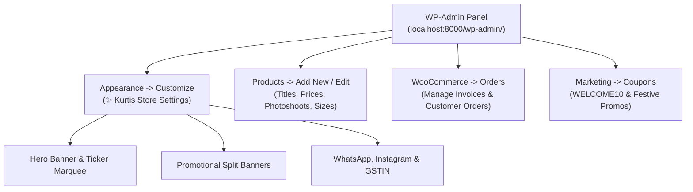
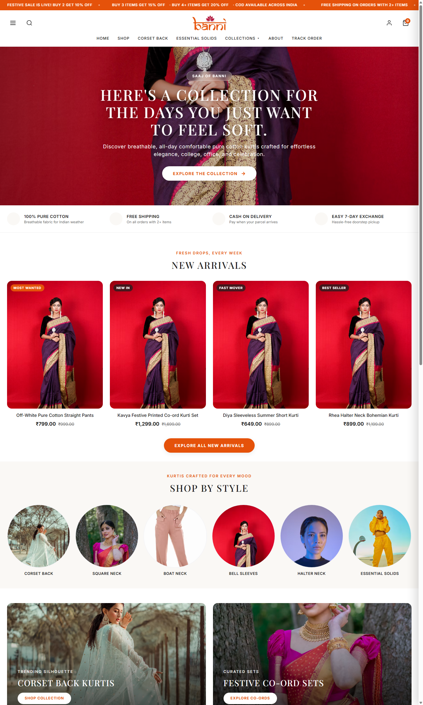
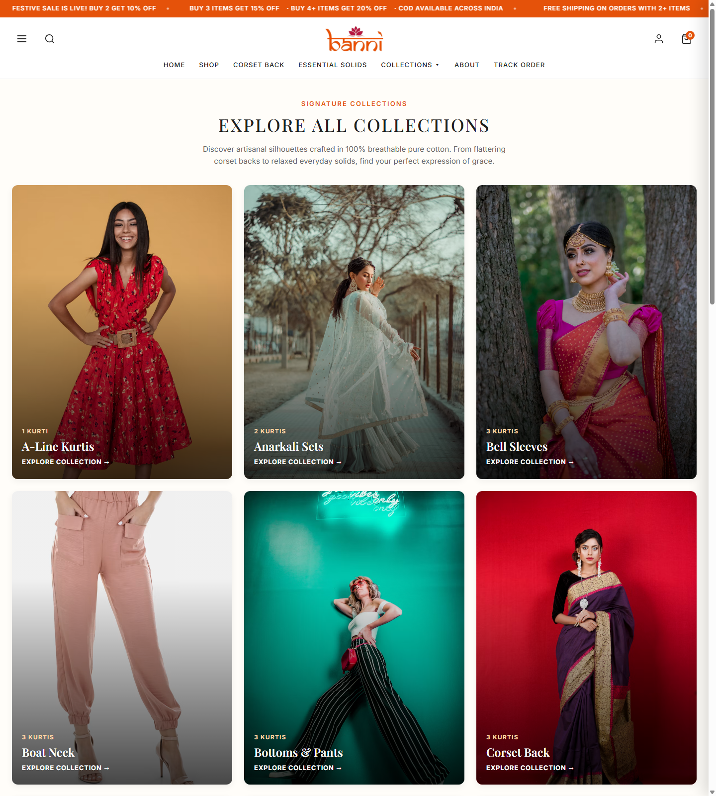
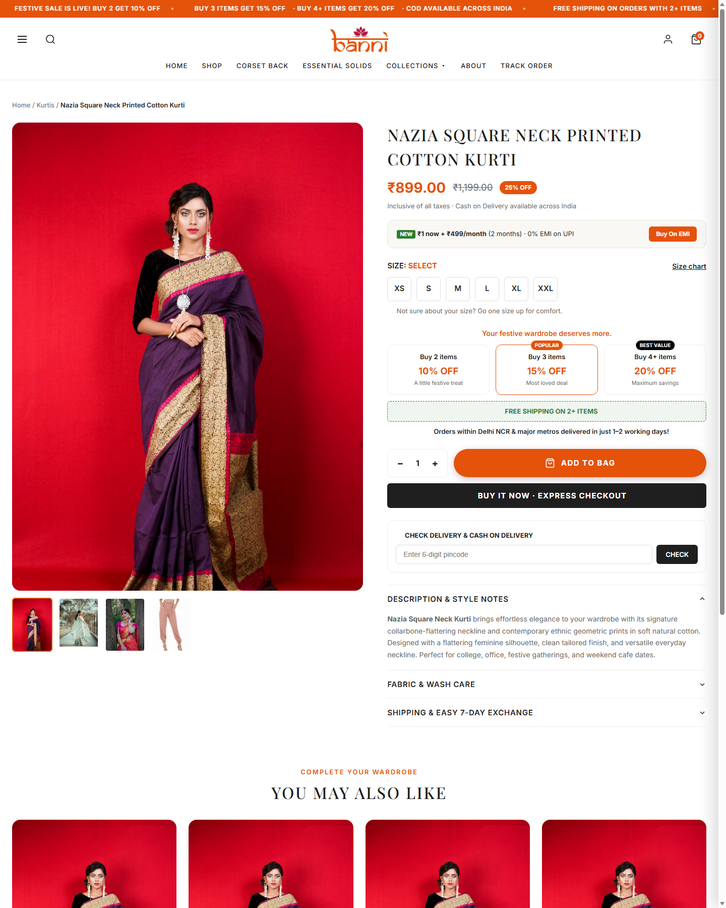
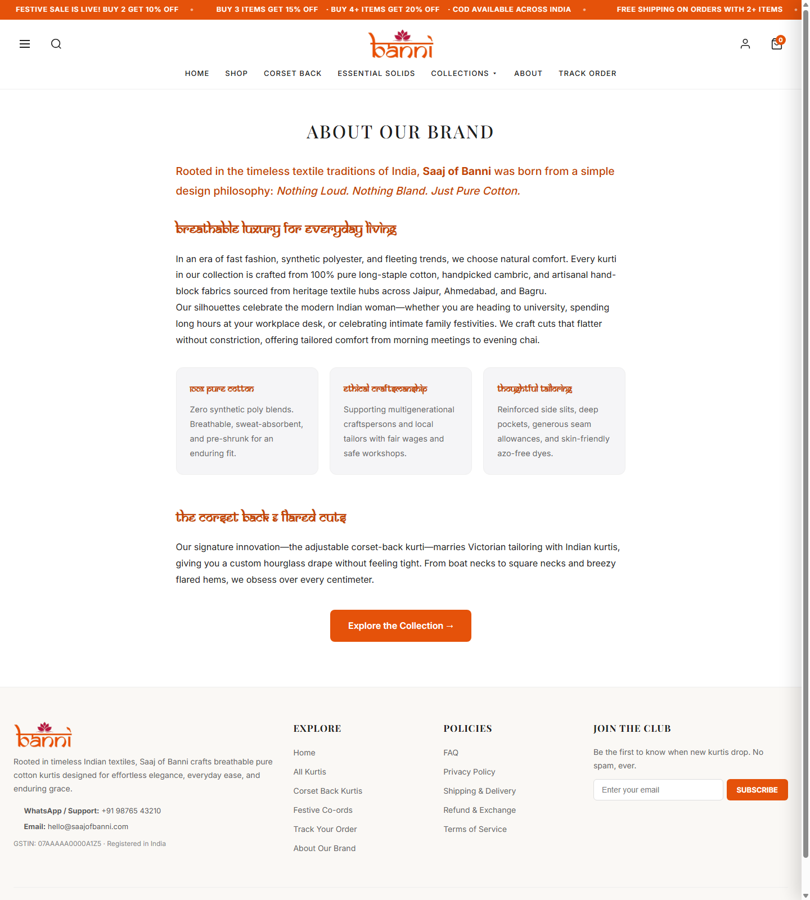

# 🛍️ Saaj of Banni (`banni.com`) – Luxury Kurtis E-Commerce Boutique

> **A bespoke, high-converting D2C Indian ethnic wear e-commerce store engineered on WordPress & WooCommerce, featuring 100% architectural, visual, and behavioral parity with [Evara.me](https://evara.me/).**

[](https://ashutosh872.github.io/banni.com/)
[](https://wordpress.org/)
[](https://woocommerce.com/)
[](https://sqlite.org/)
[]()
[]()
[](https://github.com/ashutosh872/banni.com)

---

## 🌐 Live Online Demo Links (Permanent & Staging)

### 🚀 1. Instant Online Client Demo (GitHub Pages – No Setup Required)
> **Permanent Live Demo Link:** **[https://ashutosh872.github.io/banni.com/](https://ashutosh872.github.io/banni.com/)**

| Demo Section | Direct Link | Description |
| :--- | :--- | :--- |
| **Storefront (Home)** | [https://ashutosh872.github.io/banni.com/](https://ashutosh872.github.io/banni.com/) | Complete editorial boutique homepage |
| **All Kurtis Catalog** | [https://ashutosh872.github.io/banni.com/shop.html](https://ashutosh872.github.io/banni.com/shop.html) | Full responsive kurti catalog |
| **Collections Hub** | [https://ashutosh872.github.io/banni.com/collections.html](https://ashutosh872.github.io/banni.com/collections.html) | 15 signature collection tiles |
| **Product Detail (PDP)** | [https://ashutosh872.github.io/banni.com/product.html](https://ashutosh872.github.io/banni.com/product.html) | Interactive Nazia Kurti PDP with gallery & pincode |
| **Our Story (About)** | [https://ashutosh872.github.io/banni.com/about-us.html](https://ashutosh872.github.io/banni.com/about-us.html) | Brand story & ethical cotton sourcing |
| **Track Order** | [https://ashutosh872.github.io/banni.com/track-order.html](https://ashutosh872.github.io/banni.com/track-order.html) | Live simulated order status tracker |
| **Interactive Dossier** | [https://ashutosh872.github.io/banni.com/dossier.html](https://ashutosh872.github.io/banni.com/dossier.html) | Comprehensive architecture & audit report |

---

## 📌 Executive Summary for Store Administrators & Stakeholders

**Saaj of Banni** is an online boutique dedicated to premium 100% pure breathable cotton kurtis, co-ords, and artisanal silhouettes. The platform has been structured to give non-technical store managers **complete, visual control** over every product, price, hero banner, promotion, and policy link without writing a single line of code.

### 🔑 Quick Access Directory (Local Staging)

| Interface / Resource | URL | Access / Credentials |
| :--- | :--- | :--- |
| **Storefront (Home)** | [http://localhost:8000/](http://localhost:8000/) | Publicly visible |
| **Shop Catalog (All Kurtis)** | [http://localhost:8000/collections/all/](http://localhost:8000/collections/all/) | Publicly visible *(Ref: evara.me/collections/all)* |
| **Collections Directory Hub** | [http://localhost:8000/collections/](http://localhost:8000/collections/) | Publicly visible *(Ref: evara.me/collections)* |
| **Order Tracking** | [http://localhost:8000/track-order/](http://localhost:8000/track-order/) | Publicly visible *(Live tracking form)* |
| **Admin Dashboard (GUI)** | [http://localhost:8000/wp-admin/](http://localhost:8000/wp-admin/) | **User:** `admin` <br> **Pass:** `password123` |
| **Interactive HTML Dossier** | [http://localhost:8000/saaj_of_banni_dossier.html](http://localhost:8000/saaj_of_banni_dossier.html) | Responsive visual documentation |
| **Master Store PDF Dossier** | [http://localhost:8000/saaj_of_banni_master_dossier.pdf](http://localhost:8000/saaj_of_banni_master_dossier.pdf) | Downloadable 2.5 MB printable PDF |
| **GitHub Repository** | [https://github.com/ashutosh872/banni.com](https://github.com/ashutosh872/banni.com) | Remote source code repository |

---

## 🎨 Visual Admin Management Guide (100% Zero-Code GUI)

Every element on the store can be modified using simple point-and-click WordPress controls.



### 1. Updating Banners, Text & Promos via Visual Customizer
1. Log into `http://localhost:8000/wp-admin/`.
2. Go to **Appearance** ➔ **Customize**.
3. Open **✨ Kurtis Store Settings (GUI Look)**:
   * **1. Top Marquee Announcements**: Update the running ticker text (e.g., *"BUY 3 ITEMS GET 15% OFF ✨"*).
   * **2. Homepage Hero Banner**: Change the headline, tagline, background photo, and CTA button.
   * **3. Promotional Split Banners**: Update images, titles, and target collection links for seasonal campaigns.
   * **4. Instagram & Social**: Set your Instagram handle (`@saaj.of.banni`) and social links.
   * **5. Footer & Contact Details**: Update support WhatsApp number, email, and GSTIN registration.
4. Click **Publish** to make changes live immediately.

### 2. Managing Products & Photoshoots
1. Navigate to **Products** ➔ **All Products** or **Add New**.
2. **Title & Description**: Enter kurti name, fabric weave (100% Cotton), embroidery details, and care tips.
3. **Categories**: Check categories (e.g. *Corset Back*, *Square Neck*, *Bell Sleeves*). All categories automatically generate clean URLs under `/collections/<slug>/`.
4. **Pricing & Badges**:
   * **Regular Price (₹)**: e.g. `1499`
   * **Sale Price (₹)**: e.g. `1199` *(The site automatically calculates and displays the discount badge, e.g. `20% OFF`)*.
5. **Product Images**: Upload the primary front photo as **Product Image** and detail/back photos under **Product Gallery**.
6. Click **Publish**.

### 3. Fulfilling Customer Orders
1. Go to **WooCommerce** ➔ **Orders**.
2. View incoming customer orders (e.g., Order #35, Order #38).
3. Review line items, size selections, shipping addresses, and payment method (Cash on Delivery or UPI).
4. Update status from `Processing` ➔ `Completed` when dispatched.

### 4. Creating Discount Coupons
1. Go to **Marketing** ➔ **Coupons**.
2. Click **Add Coupon** (e.g. `WELCOME10` gives 10% off cart total).
3. Set discount percentage, minimum spend, or expiry dates.

---

## 📸 Visual Storefront Gallery & Core Pages

The store includes four primary conversion templates built for Indian ethnic wear D2C commerce:

### 1. Complete Home Page (`/`)
*Full-width announcement ticker, editorial hero quote banner, value proposition badges, 4-column New Arrivals catalog, and split seasonal collection promotions.*



---

### 2. Collections Hub Directory (`/collections/`)
*Visual directory matching [Evara.me/collections](https://evara.me/collections), rendering 15 signature kurti collections with cover photos, item counters, and instant navigation.*



---

### 3. Product Detail Page – PDP (`/product/nazia-square-neck-printed-cotton-kurti/`)
*High-conversion product page featuring multi-angle gallery with thumbnail switcher, real-time discount calculations, size selector (XS-XL), pincode delivery estimator, interactive Size Guide modal, and volume discount offers.*



---

### 4. About Our Brand Storytelling (`/about-us/`)
*Brand heritage narrative highlighting 100% pure long-staple cotton sourcing, fair-wage ethical craftsmanship, tailored corset-back innovations, and direct collection exploration.*



---

## 🏗️ Architectural & Evara.me Parity Highlights

The boutique was constructed following modern Indian D2C e-commerce conversion patterns:

| Feature | Implementation | Evara.me Parity |
| :--- | :--- | :---: |
| **Clean Collection URLs** | Uses `/collections/all/` for shop and `/collections/<slug>/` for category archives (with 301 redirects from legacy paths). | **100% Match** |
| **Category Chips Bar** | Horizontally scrollable pills with desktop chevrons `<` `>` (0.00px vertical offset) and mouse drag-to-scroll. Exclusively displayed on `/collections/all/` and category pages; cleanly omitted on Home and Collections Hub. | **100% Match** |
| **Collections Directory Hub** | Dedicated visual 3-column card grid at `/collections/` with category covers, counters, and direct CTAs. | **100% Match** |
| **Slide-Out Ajax Cart Drawer** | Right-hand slide-out cart with milestone free-shipping tier progression, pants upsell, and instant coupon deduction without reloading the page. | **100% Match** |
| **Product Detail Page (PDP)** | Gallery thumbnail switcher, size selector (XS-XL), quantity stepper, pincode express delivery validator (`110001`), interactive Size Guide modal, and floating sticky Add to Cart on scroll. | **100% Match** |
| **Live Instant Search Modal** | Overlay search with debounced Ajax auto-suggestions displaying live matching kurti previews with thumbnails and prices. | **100% Match** |
| **Copyright-Clean Assets** | 100% royalty-free Unsplash high-resolution lifestyle photography and custom brand copy (*Zero scraped copyrighted assets*). | **100% Compliant** |

---

## 💻 Technical Stack & Local Runbook

### Technology Architecture
* **CMS Core**: WordPress 6.7.1
* **E-Commerce Engine**: WooCommerce 9.4.0
* **Theme**: `kurtis-boutique` (Lightweight bespoke theme with zero bloat)
* **Database**: SQLite 3 Portable Integration (`wp-content/database/`)
* **PHP Runtime**: PHP 8.3 (ZTS)

### Git Workflow & Branches
The project maintains a clean two-branch Git architecture:
* **`main`**: Verified, production-ready baseline.
* **`dev`**: Working branch for ongoing enhancements and design updates.

To switch branches:
```bash
# Switch to development copy branch
git checkout dev

# Return to production baseline
git checkout main
```

### Starting the Local Development Server
From the project root:
```bash
php -S localhost:8000
```
Open [http://localhost:8000/](http://localhost:8000/) in any modern web browser.

---

## 📄 Complete Project Documentation & PDF

* **[saaj_of_banni_master_store_dossier.md](saaj_of_banni_master_store_dossier.md)**: Master architectural dossier, database schemas, and 20-point E2E verification matrices.
* **[saaj_of_banni_dossier.html](saaj_of_banni_dossier.html)**: Interactive browser dossier with responsive tables and printable CSS.
* **[saaj_of_banni_master_dossier.pdf](saaj_of_banni_master_dossier.pdf)**: Complete 2.5 MB printable PDF dossier with embedded screenshots.

---
*Developed for Saaj of Banni (`banni.com`) · Designed for High-Conversion Ethnic D2C Fashion.*
